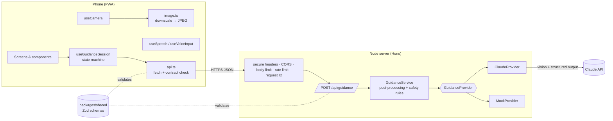
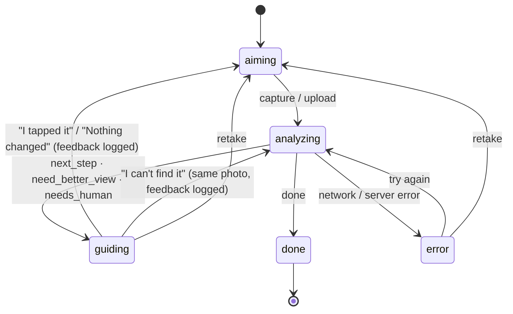

# Architecture

## Overview

## The agent loop

Each turn is one request. The agent stays stateless on the server: the client sends the goal, the current photo, and a short text history of earlier steps with the user's feedback.

The reducer is in `apps/web/src/hooks/guidanceSession.ts`. It is a pure function, so it is unit-tested without React.

## Key decisions

| Decision                                          | Reason                                                                                                                                                                                              |
| ------------------------------------------------- | --------------------------------------------------------------------------------------------------------------------------------------------------------------------------------------------------- |
| **One action per turn**                           | Older users get lost in lists of steps. A single highlighted tap, followed by verification on the next photo, is slower but much more reliable.                                                     |
| **Stateless server, history sent by the client**  | The server can scale horizontally and stores nothing. History holds only text (≤ 20 steps), never earlier photos, which keeps payloads small and protects privacy.                                  |
| **Structured output with a flat schema**          | The model fills a strict JSON schema (`ModelGuidanceSchema`). The server converts pixel boxes to normalised boxes and clamps them. The UI never parses free text.                                   |
| **Pixel boxes based on the real frame size**      | The client sends `width` and `height`, and the model answers in pixels of that image. Frames are capped at 1280px so the API does not resize them, which keeps coordinates accurate.                |
| **Safety rules in code as well as in the prompt** | `GuidanceService.postProcess` enforces minimum severity (a suspicious screen always becomes `stop` and `needs_human`, with no tap target) and fills a default message, whatever the model returned. |
| **Provider abstraction (`GuidanceProvider`)**     | Separates the route from the AI vendor. `MockProvider` powers demo mode, tests, and offline development. A new vendor needs only a new class (open/closed principle).                               |
| **`VisionModelClient` port**                      | `ClaudeProvider` depends on a narrow interface instead of the SDK, so its error mapping and refusal handling are tested without the network.                                                        |
| **Server-side refusal fallback**                  | On models that support it, `fallbacks: "default"` lets the API retry a declined request on a fallback model within the same call. If the whole chain refuses, the user is sent to staff.            |
| **Shared Zod contract**                           | Server and client import the same schemas. The client validates even successful responses before rendering.                                                                                         |
| **Practice mode as data**                         | Scenarios are plain data (`practice/scenarios.ts`). Adding a kiosk journey needs no component changes.                                                                                              |
| **Camera only while aiming**                      | The stream stops as soon as a frame is captured, which saves battery and makes privacy obvious. A generation counter discards slow `getUserMedia` results that arrive after the user has moved on.  |
| **Strict CSP, same-origin deployment**            | `default-src 'self'`, no inline scripts, and no `data:` fonts (Vite is configured not to inline them). The e2e suite fails on any CSP violation.                                                    |

## Error handling

| Where             | How                                                                                                                                                                                                      |
| ----------------- | -------------------------------------------------------------------------------------------------------------------------------------------------------------------------------------------------------- |
| Server config     | Validated with Zod at startup. The process exits with a readable message on a bad value.                                                                                                                 |
| Request input     | Zod validation returns `400 VALIDATION_ERROR` with a readable message. Body over 2.5 MB returns `413`.                                                                                                   |
| Abuse             | Fixed-window rate limiter returns `429` with `Retry-After`. The limiter is an interface, so a Redis-backed version can replace it when scaling out.                                                      |
| AI provider       | SDK errors map to typed `AppError`s: rate limit, connection or 5xx errors become `503` (retryable); a refusal becomes `422`; a 4xx from the API becomes `500` (an operator problem, logged as an error). |
| Unexpected errors | Logged with the request ID. The client gets a generic `500` without internal details.                                                                                                                    |
| Client            | `ApiError` codes map to plain-language messages with _Try again_ and _Retake photo_ actions.                                                                                                             |

## Scaling notes

- The server is stateless, so you can run several instances behind a load balancer. Swap the in-memory rate limiter for a shared store first.
- The system prompt is fixed, so it can be served from the prompt cache.
- Latency and cost: `TAPCARE_EFFORT=low` by default. Measure on real kiosk photos before raising it.
